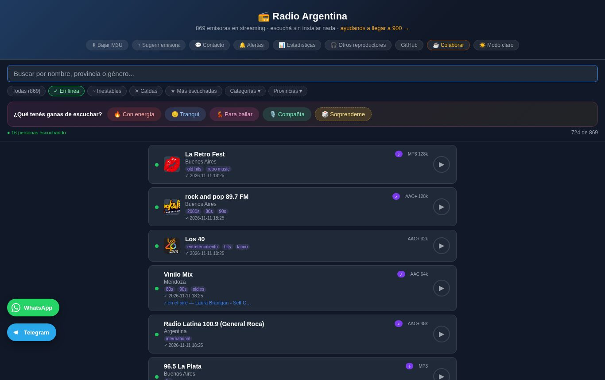
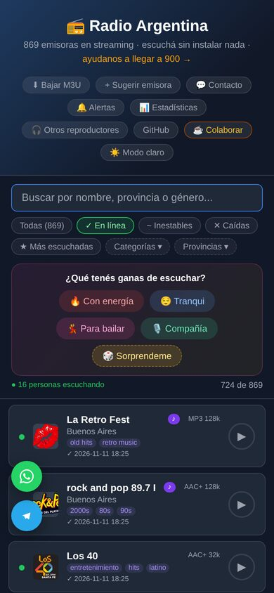

# Radio Argentina


Directorio para escuchar radios argentinas desde el navegador, sin instalar nada, y desde la terminal de Linux.

> **Proyecto cerrado el 11 de noviembre de 2026.** Estuvo en línea en `mammoli.ar/radio` y llegó a registrar 1.554 emisoras. Se dio de baja porque se llevaba la mayor parte de un hosting compartido con otros proyectos. El código queda abierto y documentado: **[COMO_VOLVER.md](COMO_VOLVER.md)** explica qué se apagó y cómo levantarla de nuevo, y [docs/VPS_PROXIMA_CASA.md](docs/VPS_PROXIMA_CASA.md) anota la idea de un servidor propio. Historia y capturas: [mammoli.ar/proyectos/radio-argentina](https://mammoli.ar/proyectos/radio-argentina/).

| Listado | Página de una emisora | En el celular |
|---|---|---|
|  |  |  |

## Contenido

- [Historia](#historia)
- [Terminal — radio2.sh](#terminal--radio2sh)
- [Player web](#player-web)
- [Arquitectura (v2)](#arquitectura-v2)
- [Crawlers](#crawlers)
- [GitHub Actions](#github-actions)
- [Configuración](#configuración-configphp)
- [Versiones](#versiones)
- [Licencia](#licencia)

## Historia

- **12/07/2021:** primer commit. Un script para la terminal con una lista de radios argentinas.
- **2026:** pasa a la web en `mammoli.ar/radio`. El 25/06 sale la v2, reescrita de cero: base de datos, una página por emisora, API REST propia y verificación automática de señales.
- **Julio–agosto de 2026:** la base SQLite se corrompe cinco veces; la causa nunca se confirmó.
- **03/09/2026:** migración a MySQL.
- **Septiembre–octubre:** canción al aire, encuestas, alertas, estadísticas, modo mantenimiento y aprendizaje de horarios de programas. Promedio: unas 270 reproducciones y entre 40 y 50 oyentes distintos por día.
- **11/11/2026:** cierre. Datos finales: 1.554 emisoras registradas, 23.791 reproducciones registradas y más de 560.000 chequeos de señal.

---

## Terminal — radio2.sh

Consume la API REST v2 en tiempo real (oyentes activos, ICY now-playing).

### Uso básico

```bash
./radio2.sh <búsqueda> [reproductor]
```

`búsqueda` puede ser parte del nombre, frecuencia, provincia o cualquier texto que aparezca en el nombre de la emisora.

```bash
./radio2.sh mendoza          # busca "mendoza" en el nombre
./radio2.sh "99.1"           # por frecuencia
./radio2.sh "cadena 3"       # nombre completo o parcial
./radio2.sh nacional         # cualquier palabra del nombre
```

### Reproductores

| Parámetro | Reproductor |
|-----------|-------------|
| *(omitido)* | mplayer |
| `m` | mplayer explícito |
| `v` | VLC headless (`cvlc`) |
| `p` | mpv |

```bash
./radio2.sh "cadena 3"       # mplayer (default)
./radio2.sh "cadena 3" v     # VLC
./radio2.sh "cadena 3" p     # mpv
```

### Alias recomendado

```bash
# ~/.bashrc o ~/.zshrc
alias radio='~/Scripts/radio/radio2.sh'
```

## Requisitos CLI

```bash
sudo apt install mplayer   # recomendado
sudo apt install vlc
sudo apt install mpv
```

---

## Player web

Estuvo en `mammoli.ar/radio` hasta el 11/11/2026. Se podía usar desde cualquier navegador, sin instalar nada.

- Buscador en tiempo real (nombre, provincia, género)
- Filtros: Activas / Dudosas / Caídas / Más escuchadas
- Filtros de género: música, noticias, pop, rock, etc.
- ICY now-playing en tiempo real (título de canción/programa)
- Badge de codec y bitrate (AAC 128k, MP3 64k, etc.)
- Contador de oyentes en tiempo real
- Compartir por link, WhatsApp o QR
- Abrir stream en VLC desde el browser
- Encuesta de satisfacción (👍 / 😐 / 👎)
- PWA: instalable en celular, funciona offline
- Dark/light mode

### Parámetros de URL

```
# Filtro de género al abrir
mammoli.ar/radio/?genero=noticias
mammoli.ar/radio/?genero=pop

# Filtro de estado
mammoli.ar/radio/?estado=ok       # solo activas
mammoli.ar/radio/?estado=all      # todas

# Combinar
mammoli.ar/radio/?genero=noticias&estado=ok

# Descargar playlist M3U (para VLC, apps IPTV, etc.)
mammoli.ar/radio/?m3u=1
mammoli.ar/radio/api/playlist.m3u

# Buscar server-side (útil para scripts)
mammoli.ar/radio/?buscar=cadena+3

# Página de emisora individual
mammoli.ar/radio/{slug}/
```

---

## Arquitectura (v2)

```
web/
├── index.php          ← router (35 líneas)
├── admin.php          ← panel de administración (auth requerida)
├── sitemap.php        ← sitemap dinámico desde SQLite
├── api/
│   ├── stations.php   ← GET /api/stations[?slug=]
│   ├── playlist.php   ← GET /api/playlist.m3u
│   ├── listeners.php  ← ping/stop/count/top
│   ├── nowplaying.php ← ICY metadata
│   ├── survey.php     ← POST rating + location
│   ├── suggest.php    ← POST sugerencia de emisora
│   └── share.php      ← notificación de compartir
├── pages/
│   ├── listing.php    ← directorio principal
│   └── station.php    ← página individual (SEO, JSON-LD)
├── components/
│   └── head.php       ← <head> compartido
└── assets/
    ├── player.js      ← RadioPlayer() — estados idle/connecting/playing/buffering/error
    ├── player.css     ← estilos del player
    ├── theme.js       ← dark/light toggle
    └── style.css      ← CSS global

crawlers/
├── check_streams_v2.py  ← verifica streams (30 workers paralelos), detecta cambios
├── enrich_v2.py         ← enriquece con Radio Browser API (logo, codec, bitrate)
├── hunt_stations_v2.py  ← descubre emisoras nuevas
└── icy_refresh.php      ← refresca ICY titles (cURL Multi, 20 concurrentes, cron 10min)

db/
└── radio_v2.sqlite    ← base de datos (gitignoreada)
```

### Base de datos

SQLite con 9 tablas + 2 vistas:

| Tabla | Contenido |
|---|---|
| `stations` | directorio de emisoras |
| `stream_status` | estado actual por emisora |
| `stream_history` | historial de verificaciones |
| `station_events` | eventos: came_back, went_down, icy_gained, icy_lost |
| `icy_cache` | título ICY actual por emisora |
| `plays` | historial de reproducciones |
| `listeners` | oyentes activos (TTL 90s) |
| `surveys` | calificaciones de usuarios |
| `crawler_runs` | log de ejecuciones de crawlers |

Vistas: `v_stations` (join completo), `v_active_listeners`.

---

## Crawlers

### check_streams_v2.py — verificación periódica de URLs

Verifica todas las emisoras en paralelo (30 workers). Detecta cambios y genera eventos:

```bash
python3 crawlers/check_streams_v2.py            # verificar sin notificar
python3 crawlers/check_streams_v2.py --notify   # notifica cambios por Telegram
python3 crawlers/check_streams_v2.py --icy      # también refresca ICY titles
python3 crawlers/check_streams_v2.py --workers 40
```

Corre automáticamente cada 6hs via GitHub Actions (`check-streams-v2.yml`).

### enrich_v2.py — enriquecimiento de metadatos

Actualiza logo, tags, codec, bitrate y votos desde Radio Browser API:

```bash
python3 crawlers/enrich_v2.py
```

Corre automáticamente los días 1 y 15 de cada mes via GitHub Actions (`enrich-v2.yml`).

### hunt_stations_v2.py — descubrimiento de emisoras

Busca emisoras argentinas nuevas en Radio Browser y las inserta con `approved=0` para revisión:

```bash
python3 crawlers/hunt_stations_v2.py
```

### icy_refresh.php — ICY now-playing en tiempo real

Script PHP para cPanel cron. Barre todas las emisoras con `icy_supported=1` usando cURL Multi (20 conexiones concurrentes) y actualiza `icy_cache`. Corre cada 10 minutos.

---

## GitHub Actions

**Todos desactivados desde el 11/11/2026** (no borrados). Lista completa, horarios y secretos en [COMO_VOLVER.md](COMO_VOLVER.md#workflows-de-github-actions-desactivados).

Mientras estuvieron activos, descargaban la base por FTP, corrían el crawler y subían la base actualizada.

---

## Configuración (`config.php`)

Copiar `config.example.php` como `config.php` y completar:

```php
define('RADIO_ADMIN_KEY', '...');   // clave interna de API
define('ADMIN_USER', 'admin');       // usuario del panel /admin.php
define('ADMIN_PASS', '...');         // contraseña del panel
define('TG_TOKEN',  '...');          // token del bot de Telegram
define('TG_CHAT_ID', '...');         // chat donde notificar
define('NOTIFY_OYENTES', false);     // true = notificar nuevos oyentes
define('GA_ID', '');                 // Google Analytics 4 (vacío = desactivado)
// Opcional:
define('RADIO_DB', '/ruta/a/radio_v2.sqlite');
define('RADIO_BASE', '/radio');      // prefijo URL (para staging en subpath)
```

---

## Panel de administración

Accesible en `/radio/admin.php` con usuario y contraseña (configurados en `config.php`).

Secciones: resumen de estadísticas, encuestas con resultado por estación, sugerencias de nuevas emisoras (aprobar/rechazar), ICY titles activos con indicador de frescura, log de crawlers.

---

## Versiones

Un solo branch (`master` = producción). Las versiones se marcan con tags:

| Tag | Descripción |
|---|---|
| `v1-final` | último estado de v1 antes del cutover a v2 (2026-06-25) |
| `v2-final` | último estado de v2, al cerrar (2026-11-11) |

---

## Directorio como gist

El listado completo de emisoras está disponible públicamente en formato TSV (URL, nombre, provincia):

**[gist.github.com/camammoli/21ce6e3ba07486bcd16a28cda967f0d9](https://gist.github.com/camammoli/21ce6e3ba07486bcd16a28cda967f0d9)**

Es un fork del [gist original de pisculichi](https://gist.github.com/pisculichi/fae88a2f5570ab22da53). Se actualizaba cada lunes con `gist-sync.yml`; quedó congelado con la lista del cierre. Para actualizar manualmente:

```bash
python3 gist_sync.py --dry-run   # previsualizar sin enviar
python3 gist_sync.py             # actualizar (requiere GITHUB_TOKEN con scope gist)
```

---

## Licencia

MIT License — Carlos Ariel Mammoli (LU2MCA), Mendoza, Argentina
